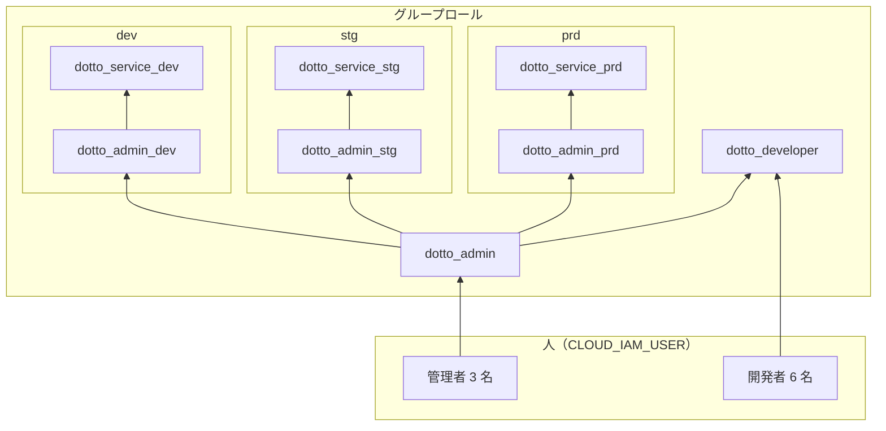
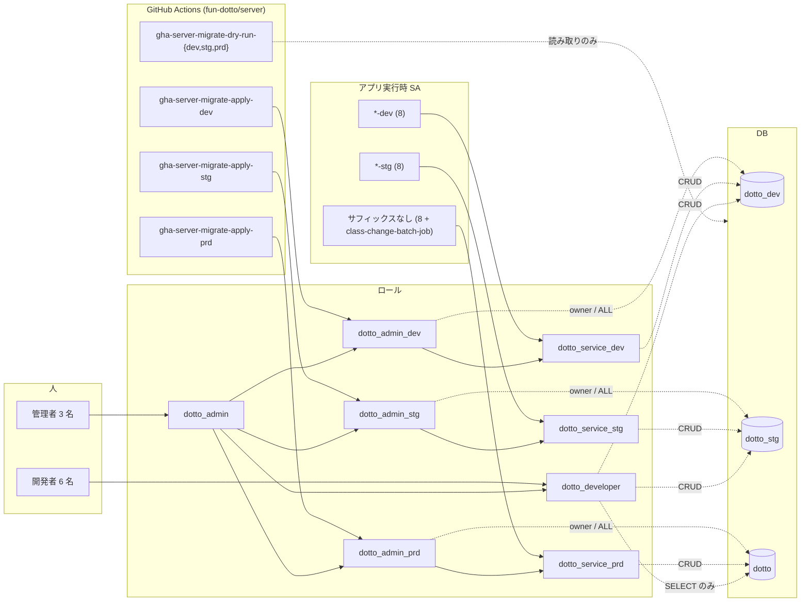

# PostgreSQL ロール設計

Cloud SQL インスタンス `dotto`（PostgreSQL 18）のロール構成と、DB マイグレーション用 SA を環境ごとに分けた後の対応関係をまとめる。

- 状態: **目標構成（案）**。Terraform・SQL は未反映。
- 現行の構成は [現状との差分](#現状との差分) を参照。
- マイグレーション運用は [atlas-migration.md](./atlas-migration.md) を参照。

## 前提

- 1 インスタンスに環境ごとの DB がある。**ロールはインスタンス共通**なので、環境の分離は「ロールを環境ごとに分ける」＋「DB 単位の `CONNECT` / オブジェクト権限」で行う。

| 環境 | DB 名 | 実行時 SA の命名 |
| --- | --- | --- |
| dev | `dotto_dev` | `<name>-dev` |
| stg | `dotto_stg` | `<name>-stg` |
| prd | `dotto` | `<name>`（サフィックスなし） |

- IAM ユーザーの DB 上の名前: 人は Google アカウントのメールアドレス、SA は `<account_id>@swift2023groupc.iam`。

## ロール一覧

| ロール | 種別 | 用途 | 権限の範囲 |
| --- | --- | --- | --- |
| `dotto_admin` | グループ | 人間の管理者。全環境の管理 | 全環境の `dotto_admin_*` と `dotto_developer` のメンバー（`SET ROLE` で切替可） |
| `dotto_admin_dev` | グループ | dev のマイグレーション実行・オブジェクトの owner | `dotto_dev` の DDL / 全権限 |
| `dotto_admin_stg` | グループ | stg のマイグレーション実行・オブジェクトの owner | `dotto_stg` の DDL / 全権限 |
| `dotto_admin_prd` | グループ | prd のマイグレーション実行・オブジェクトの owner | `dotto` の DDL / 全権限 |
| `dotto_service_dev` | グループ | dev のアプリ実行時 | `dotto_dev` の `SELECT, INSERT, UPDATE, DELETE` |
| `dotto_service_stg` | グループ | stg のアプリ実行時 | `dotto_stg` の `SELECT, INSERT, UPDATE, DELETE` |
| `dotto_service_prd` | グループ | prd のアプリ実行時 | `dotto` の `SELECT, INSERT, UPDATE, DELETE` |
| `dotto_developer` | グループ | 開発者の調査・検証 | dev / stg は `SELECT, INSERT, UPDATE, DELETE`、prd は `SELECT` のみ |

## ロールの親子関係

「A → B」は「A は B のメンバー（A が B の権限を継承する）」を表す。

| メンバー | 親ロール | 目的 |
| --- | --- | --- |
| `dotto_admin` | `dotto_admin_dev` / `dotto_admin_stg` / `dotto_admin_prd` | 人の管理者が各環境の owner として操作する |
| `dotto_admin` | `dotto_developer` | 管理者も開発者と同じ調査権限を持つ（現行踏襲） |
| `dotto_admin_<env>` | `dotto_service_<env>` | owner が自環境のアプリ権限を持つ（現行の `dotto_admin` → `dotto_service` 相当を環境内に限定） |

`dotto_admin_<env>` どうしは独立しており、`dotto_admin_dev` は stg / prd のオブジェクトに触れない。

## SA / IAM ユーザーとロールの対応

### マイグレーション用 SA（環境ごとに分割）

| SA（account_id） | DB 上のユーザー | 所属ロール | 用途 | WIF で借用できる条件 |
| --- | --- | --- | --- | --- |
| `gha-server-migrate-apply-dev` | `gha-server-migrate-apply-dev@swift2023groupc.iam` | `dotto_admin_dev` | dev へ適用 | `fun-dotto/server` の Environment `dev` |
| `gha-server-migrate-apply-stg` | `gha-server-migrate-apply-stg@swift2023groupc.iam` | `dotto_admin_stg` | stg へ適用 | 同 Environment `stg` |
| `gha-server-migrate-apply-prd` | `gha-server-migrate-apply-prd@swift2023groupc.iam` | `dotto_admin_prd` | prd へ適用 | 同 Environment `prd`（承認者必須・保護ブランチ限定） |
| `gha-server-migrate-dry-run-dev` | `gha-server-migrate-dry-run-dev@swift2023groupc.iam` | 下記 ※ | dev への dry-run | `fun-dotto/server` の任意のワークフロー |
| `gha-server-migrate-dry-run-stg` | `gha-server-migrate-dry-run-stg@swift2023groupc.iam` | 下記 ※ | stg への dry-run | 同上 |
| `gha-server-migrate-dry-run-prd` | `gha-server-migrate-dry-run-prd@swift2023groupc.iam` | 下記 ※ | prd への dry-run | 同上 |

※ dry-run 用のロールは今回の指定に含まれていないため未確定。現行の `dotto_migrate_readonly`（`NOLOGIN`、リビジョンテーブルの `SELECT` のみ）を環境ごとの DB に対して使い続けるのが最も安全。`dotto_developer` に寄せる場合、dev / stg では書き込み権限が付くため dry-run SA には過剰になる。

- `account_id` の上限は 30 文字。`gha-server-migrate-dry-run-stg` はちょうど 30 文字。
- 各 SA の `DB 接続先` は自環境の DB のみ（`dotto_admin_<env>` には他環境 DB への `CONNECT` を付与しない）。

### アプリ実行時 SA

| 環境 | ロール | 所属する SA（DB ユーザー名は `<name>@swift2023groupc.iam`） |
| --- | --- | --- |
| dev | `dotto_service_dev` | `academic-svc-dev` / `admin-api-dev` / `announcement-svc-dev` / `app-api-dev` / `bld-irr-noti-job-dev` / `import-gtfs-job-dev` / `noti-user-job-dev` / `user-svc-dev` |
| stg | `dotto_service_stg` | `academic-svc-stg` / `admin-api-stg` / `announcement-svc-stg` / `app-api-stg` / `bld-irr-noti-job-stg` / `import-gtfs-job-stg` / `noti-user-job-stg` / `user-svc-stg` |
| prd | `dotto_service_prd` | `academic-svc` / `admin-api` / `announcement-svc` / `app-api` / `bld-irr-noti-job` / `import-gtfs-job` / `noti-user-job` / `user-svc` / `class-change-batch-job`（※） |

※ `class-change-batch-job` は現行の DB には存在するが `terraform/google/foundation/cloud-sql/locals.tf` の `database_service_accounts` に無い（Terraform 管理外）。ロール移行時に Terraform へ取り込むか削除するか決める。

### 人（IAM ユーザー）

| 所属ロール | IAM ユーザー |
| --- | --- |
| `dotto_admin` | `iam@kantacky.com` / `msyaaa456910@gmail.com` / `beretta0602@gmail.com` |
| `dotto_developer` | `axitian882@gmail.com` / `identityv5656@gmail.com` / `kaxu123456@gmail.com` / `tash19695@gmail.com` / `yamas.jto@gmail.com` / `yonggoutwitter89@gmail.com` |

### 全体像

## DB ごとの権限

「接続できる」= `CONNECT`、「owner」= テーブル等の所有者。

| ロール | `dotto_dev` | `dotto_stg` | `dotto`（prd） |
| --- | --- | --- | --- |
| `dotto_admin_dev` | owner / `ALL` | 接続不可 | 接続不可 |
| `dotto_admin_stg` | 接続不可 | owner / `ALL` | 接続不可 |
| `dotto_admin_prd` | 接続不可 | 接続不可 | owner / `ALL` |
| `dotto_service_dev` | `SELECT, INSERT, UPDATE, DELETE` | 接続不可 | 接続不可 |
| `dotto_service_stg` | 接続不可 | `SELECT, INSERT, UPDATE, DELETE` | 接続不可 |
| `dotto_service_prd` | 接続不可 | 接続不可 | `SELECT, INSERT, UPDATE, DELETE` |
| `dotto_developer` | `SELECT, INSERT, UPDATE, DELETE` | `SELECT, INSERT, UPDATE, DELETE` | `SELECT` のみ |
| `dotto_admin` | 各 `dotto_admin_*` 経由で全環境 owner / `ALL` | ← 同左 | ← 同左 |

## 現状との差分

現行（`\drg` の出力）から次が変わる。

| 項目 | 現行 | 目標 |
| --- | --- | --- |
| マイグレーション適用 SA | `gha-server-migrate-apply` 1 つ（`dotto_admin` に所属） | 環境ごとに 3 つ（`dotto_admin_<env>` に所属） |
| dry-run SA | `gha-server-migrate-dry-run` 1 つ（`dotto_migrate_readonly`） | 環境ごとに 3 つ |
| アプリ実行時ロール | `dotto_service` を全環境で共有 | `dotto_service_<env>` に分割 |
| `dotto_admin` の位置づけ | `dotto_developer` / `dotto_service` / `dotto_migrate_readonly` の親。SA も所属 | 人間の管理者専用。各 `dotto_admin_<env>` の親 |
| 環境間の分離 | ロール上は無し（`dotto_service` は全 DB に同じ権限） | ロール単位で分離。他環境 DB へは `CONNECT` 不可 |
| `class-change-batch-job` | DB にのみ存在（Terraform 管理外） | Terraform 管理に取り込む（要判断） |

## 移行に必要な作業（概要）

1. **ロール作成**（`dotto_admin` で実行）: `dotto_admin_{dev,stg,prd}`、`dotto_service_{dev,stg,prd}` を `NOLOGIN` で作成し、上記のメンバーシップを `GRANT` する。
2. **DB の接続制限**: 各 DB で `REVOKE CONNECT ON DATABASE <db> FROM PUBLIC` した上で、対応する環境のロールにだけ `GRANT CONNECT` する。
3. **オブジェクトの owner 付け替え**: 各 DB のスキーマ・テーブル・シーケンス（`atlas_schema_revisions` スキーマ含む）を `dotto_admin_<env>` に `REASSIGN OWNED` / `ALTER ... OWNER TO` し、`ALTER DEFAULT PRIVILEGES FOR ROLE dotto_admin_<env>` を `dotto_service_<env>` と `dotto_developer`（prd は `SELECT` のみ）に設定し直す。
4. **Terraform**:
   - `iam-workload-identity`: マイグレーション用 SA を環境ごとに作成。適用用 SA の `roles/iam.workloadIdentityUser` は対応する Environment のみ許可する。
   - `cloud-sql/locals.tf` / `users.tf`: `database_service_accounts` を環境別に分け、`google_sql_user.service_account` の `database_roles` を `dotto_service_<env>` にする。マイグレーション用ユーザーも同様に環境別にする。
5. **`fun-dotto/server` のワークフロー**: Environment ごとに使う SA（`workload_identity_provider` の `service_account`）と接続時の `role`（`dotto_admin_<env>`）を切り替える。
6. 切り替え完了後、旧 SA（`gha-server-migrate-apply` / `gha-server-migrate-dry-run`）と旧ロール（`dotto_service`、`dotto_migrate_readonly`）を削除する。

切り替えの順序は dev → stg → prd とし、各環境でアプリが新ロールで接続できることを確認してから旧ロールを外す。
